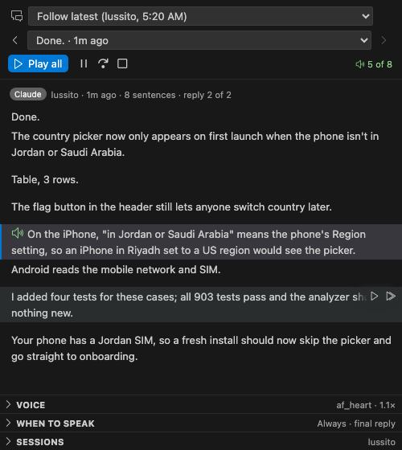

# claude-voice

Claude Code reads its replies aloud with [Kokoro](https://github.com/thewh1teagle/kokoro-onnx), a natural-sounding voice that runs entirely on your computer. No account, no API key, nothing leaves your machine.


<sub>The GIF has no sound: each sentence turns green as the voice reads it.</sub>

- **Speaks while it types.** Each sentence is read as soon as it is written.
- **Speak pane.** Every reply as a list of sentences: play one, read from any line on, pause, skip, stop, switch between replies, reload the whole chat.
- **Live highlight.** The sentence being spoken turns green.
- **Tech-aware.** Paths read as file names, links as their site, versions as "1 point 2", `snake_case` as two words, symbols like → and ≥ as words, code blocks and tables as a short note ("Python code, 12 lines"), and a pronunciation list (RAM, JSON, macOS, ...) you can extend.
- **Secrets stay quiet.** API keys, bearer tokens and `--token` values are read as "redacted".
- **Work updates or just the answer.** Hear the notes Claude writes between tool calls too, or turn work updates off to hear only the final reply.
- **Tells you when it is waiting.** Claude's questions are always said aloud, ahead of everything else. When you are away from the terminal, permission prompts and plans are too, and a long turn ends with "All done."
- **Several sessions.** Replies queue instead of talking over each other, with a short "From <project>" label, and each project can have its own voice.
- **Settings in the pane.** Voice, speed, mute, speak only when you are away from the terminal, speak while typing, work updates, summaries of long replies. British voices get British pronunciation.
- **Other agents and editors.** Codex, Gemini CLI, Cursor and any MCP client can use the same voice, and a VS Code extension shows every reply with a sentence player.
- **Timed mute.** `/mute 30m`, `/mute 2h`, `/mute until 3pm`, `/mute off`.

## Install

Works on macOS (Apple Silicon and Intel), Linux (x86_64 and arm64) and Windows (x64 and ARM64), with about 400 MB for the voice. Python 3.10 to 3.13 is used if you have it; otherwise the installer fetches a private copy with [uv](https://astral.sh/uv).

The quickest way in VS Code, Cursor or Windsurf: install **Read Aloud for Claude Code** from the extension marketplace, open its panel and click **Set up**. Everything below happens in one step, with progress shown.

**macOS and Linux**

```sh
git clone https://github.com/Abdalrhman-Attar/claude-voice.git
cd claude-voice
./install.sh
```

On Linux, playback needs PortAudio: `sudo apt install libportaudio2` (Fedora: `sudo dnf install portaudio`).

**Windows** (PowerShell)

```powershell
git clone https://github.com/Abdalrhman-Attar/claude-voice.git
cd claude-voice
powershell -ExecutionPolicy Bypass -File install.ps1
```

The installer creates `~/.claude/kokoro` (Python environment, model files, settings), starts the voice server at login (a LaunchAgent on macOS, a systemd user service on Linux, a Run entry on Windows), binds **ctrl+x s** to Stop, and adds the Claude Code plugin when the `claude` command is found.

The voice server also reads Claude Code's session files, so finished replies are spoken even without the plugin. The plugin adds speech while Claude types, the in-terminal Speak pane and per-sentence controls.

If the plugin was not added automatically, in Claude Code:

```
/plugin install speak-pane --marketplace Abdalrhman-Attar/claude-voice
/reload-plugins
```

Open the pane with `/speak` (it opens by itself in a terminal 144 columns or wider).

## VS Code extension



**Read Aloud for Claude Code** (in `vscode/`) adds a Replies panel to VS Code, Cursor and Windsurf. It uses VS Code's own icons and your theme's colors.

- **Sessions and replies.** A session picker, grouped by agent (Claude Code, Codex, Gemini CLI, Cursor), keeps two sessions in the same folder apart; "Follow latest" switches to whichever spoke last. By default only sessions working in the window's folder are listed.
- **Sentence player.** Click a sentence to read from it; on hover, ▷ reads just that sentence and ⏩ reads to the end. The spoken sentence is highlighted and kept in view.
- **Controls everywhere.** Play all, pause, skip and stop in the panel, the status bar, and the keyboard: ctrl+cmd+. stop, ctrl+cmd+, pause, ctrl+cmd+/ skip (ctrl+alt on Windows and Linux).
- **Settings** in collapsible sections (Voice, When to speak, Sessions), shared with the Claude Code plugin.

Install the `.vsix` from the [latest release](https://github.com/Abdalrhman-Attar/claude-voice/releases/latest), or build it:

```sh
cd vscode && npm install && npm run package
code --install-extension read-aloud-for-claude-code-*.vsix          # add --profile <name> if you use a VS Code profile
```

It works on its own: **Set up** in the panel installs the voice (fetching Python if needed) and the Claude Code plugin, and finished replies are spoken from Claude Code's session files even without the plugin. Sessions show Claude Code's own titles. `npm test` in `vscode/` runs its integration tests in a real VS Code.

## Other agents

The same voice can read replies from Codex, Gemini CLI and Cursor, and any MCP client can call it. Every agent shares one queue, so they take turns instead of talking over each other, each introduced as "From Codex in my-app" when several are active. Mute, only when away and summaries follow the Speak pane's settings.

```sh
./install.sh --agents codex,gemini,cursor,mcp     # or any of them; safe to re-run
```

| Agent | How it hooks in | Reads |
| --- | --- | --- |
| Codex | `notify` in `~/.codex/config.toml` | each finished reply |
| Gemini CLI | `AfterAgent` and `Notification` hooks in `~/.gemini/settings.json` | each reply, and permission prompts when you are away |
| Cursor | `afterAgentResponse` in `~/.cursor/hooks.json` (Cursor 1.7 or newer) | each reply |
| Any MCP client | `server/mcp_server.py`, tools `speak` and `stop_speaking` | what the agent chooses to say |

The Speak pane, live speech while typing and per-sentence controls are Claude Code only. Other agents are read once their reply is finished. Code blocks and tables are described, not read, and long replies are cut to their first paragraph when summaries are on.

To disconnect: `~/.claude/kokoro/.venv/bin/python server/install_helper.py disconnect codex,gemini,cursor` (also done by `--uninstall`).

## Use

| Key (in the pane) | Does |
| --- | --- |
| click a line | play that sentence |
| `»` | read from that line to the end |
| `p` | play the whole reply |
| `a` | pause or resume |
| `x` | skip to the next sentence |
| `s`, ctrl+x s, `/hush` | stop |
| `/mute [30m, until 3pm, off]` | mute for a while |
| `b` / `n` | previous / next reply |
| `j` / `k` | scroll the sentence list |
| `r` | load every reply of this chat |
| `v`, `m` | next voice, mute |

Sending a message stops the current reply.

## Pronunciation

Add words to `~/.claude/kokoro/pronounce.json`, as the word mapped to how it should sound:

```json
{ "Careem": "kareem", "kubectl": "cube control" }
```

Changes apply to the next sentence.

## Files

| Where | What |
| --- | --- |
| `hooks/` | the Claude Code plugin (pane, live speech, settings) |
| `server/` | the voice server and its client, the agent hooks and MCP server, the chat history reader, the installer helper |
| `vscode/` | the Read Aloud for Claude Code extension for VS Code, Cursor and Windsurf |
| `~/.claude/kokoro/` | environment, models, `settings.json`, `pronounce.json`, `replies.json`, `status.json`, `server.log` |

## Platform notes

- **Only when away** checks whether your terminal is the window in front. On macOS it asks the system which app is in front. On Windows and Linux (X11, with `xdotool` or `xprop`) it looks for its own terminal among the processes above Claude. On Wayland, or inside tmux on Linux, it cannot tell, so it treats you as away.
- On Windows the client and server talk over a localhost port, with a random token only your user can read. Elsewhere they use a unix socket.

## Uninstall

```sh
./install.sh --uninstall                                      # macOS, Linux
powershell -ExecutionPolicy Bypass -File install.ps1 -Uninstall   # Windows
```

then `/plugin uninstall speak-pane` and delete `~/.claude/kokoro`.
