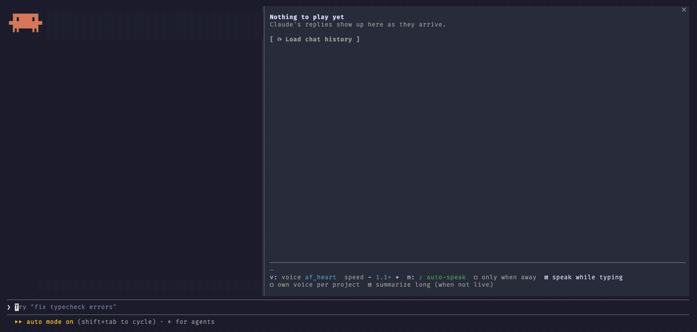

# claude-voice

Claude Code reads its replies aloud with [Kokoro](https://github.com/thewh1teagle/kokoro-onnx), a natural-sounding voice that runs entirely on your computer. No account, no API key, nothing leaves your machine.



<sub>The GIF has no sound: each sentence turns green as the voice reads it.</sub>

- **Speaks while it types.** Each sentence is read as soon as it is written.
- **Speak pane.** Every reply as a list of sentences: play one, read from any line on, pause, skip, stop, switch between replies, reload the whole chat.
- **Live highlight.** The sentence being spoken turns green.
- **Tech-aware.** Paths read as file names, links as their site, versions as "1 point 2", `snake_case` as two words, symbols like → and ≥ as words, code blocks and tables as a short note ("Python code, 12 lines"), and a pronunciation list (RAM, JSON, macOS, ...) you can extend.
- **Secrets stay quiet.** API keys, bearer tokens and `--token` values are read as "redacted".
- **Tells you when it is waiting.** When you are away from the terminal, permission prompts, questions and plans are said aloud ahead of everything else, and a long turn ends with "All done."
- **Several sessions.** Replies queue instead of talking over each other, with a short "From <project>" label, and each project can have its own voice.
- **Settings in the pane.** Voice, speed, mute, speak only when you are away from the terminal, summaries of long replies. British voices get British pronunciation.
- **Timed mute.** `/mute 30m`, `/mute 2h`, `/mute until 3pm`, `/mute off`.

## Install

Works on macOS (Apple Silicon and Intel), Linux (x86_64 and arm64) and Windows (x64 and ARM64). Needs Python 3.10 to 3.13 (3.12 or newer on Windows ARM) and about 350 MB for the voice model.

**macOS and Linux**

```sh
git clone https://github.com/Abdalrhman-Attar/claude-voice.git
cd claude-voice
./install.sh
```

On Linux, playback needs PortAudio: `sudo apt install libportaudio2` (Fedora: `sudo dnf install portaudio`).

**Windows** (PowerShell)

```powershell
git clone https://github.com/Abdalrhman-Attar/claude-voice.git
cd claude-voice
powershell -ExecutionPolicy Bypass -File install.ps1
```

The installer creates `~/.claude/kokoro` (Python environment, model files, settings), starts the voice server at login (a LaunchAgent on macOS, a systemd user service on Linux, a Run entry on Windows), and binds **ctrl+x s** to Stop.

Then, in Claude Code:

```
/plugin install speak-pane --marketplace Abdalrhman-Attar/claude-voice
/reload-plugins
```

Open the pane with `/speak` (it opens by itself in a terminal 144 columns or wider).

## Other agents

The same voice can read replies from Codex, Gemini CLI and Cursor, and any MCP client can call it. Every agent shares one queue, so they take turns instead of talking over each other, each introduced as "From Codex in my-app" when several are active. Mute, only when away and summaries follow the Speak pane's settings.

```sh
./install.sh --agents codex,gemini,cursor,mcp     # or any of them; safe to re-run
```

| Agent | How it hooks in | Reads |
| --- | --- | --- |
| Codex | `notify` in `~/.codex/config.toml` | each finished reply |
| Gemini CLI | `AfterAgent` and `Notification` hooks in `~/.gemini/settings.json` | each reply, and permission prompts when you are away |
| Cursor | `afterAgentResponse` in `~/.cursor/hooks.json` (Cursor 1.7 or newer) | each reply |
| Any MCP client | `server/mcp_server.py`, tools `speak` and `stop_speaking` | what the agent chooses to say |

The Speak pane, live speech while typing and per-sentence controls are Claude Code only. Other agents are read once their reply is finished. Code blocks and tables are described, not read, and long replies are cut to their first paragraph when summaries are on.

To disconnect: `~/.claude/kokoro/.venv/bin/python server/install_helper.py disconnect codex,gemini,cursor` (also done by `--uninstall`).

## Use

| Key (in the pane) | Does |
| --- | --- |
| click a line | play that sentence |
| `»` | read from that line to the end |
| `p` | play the whole reply |
| `a` | pause or resume |
| `x` | skip to the next sentence |
| `s`, ctrl+x s, `/hush` | stop |
| `/mute [30m, until 3pm, off]` | mute for a while |
| `b` / `n` | previous / next reply |
| `j` / `k` | scroll the sentence list |
| `r` | load every reply of this chat |
| `v`, `m` | next voice, mute |

Sending a message stops the current reply.

## Pronunciation

Add words to `~/.claude/kokoro/pronounce.json`, as the word mapped to how it should sound:

```json
{ "Careem": "kareem", "kubectl": "cube control" }
```

Changes apply to the next sentence.

## Files

| Where | What |
| --- | --- |
| `hooks/` | the Claude Code plugin (pane, live speech, settings) |
| `server/` | the voice server, its client and the chat history reader |
| `~/.claude/kokoro/` | environment, models, `settings.json`, `pronounce.json`, `server.log` |

## Platform notes

- **Only when away** checks whether your terminal is the window in front. On macOS it asks the system which app is in front. On Windows and Linux (X11, with `xdotool` or `xprop`) it looks for its own terminal among the processes above Claude. On Wayland, or inside tmux on Linux, it cannot tell, so it treats you as away.
- On Windows the client and server talk over a localhost port, with a random token only your user can read. Elsewhere they use a unix socket.

## Uninstall

```sh
./install.sh --uninstall                                      # macOS, Linux
powershell -ExecutionPolicy Bypass -File install.ps1 -Uninstall   # Windows
```

then `/plugin uninstall speak-pane` and delete `~/.claude/kokoro`.
